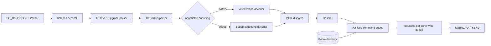

# Architecture

The server is a single-backend io_uring reactor. There is no readiness
abstraction and no second backend: every operation is submitted to a ring and
completed with an integer `(op, slot, generation)` tag. See
`docs/adr/0012-io-uring-only.md`.

TLS terminates at a load balancer or reverse proxy. The library speaks plaintext
`ws://` only. See `docs/adr/0013-tls-terminates-upstream.md`.

## Vertical slices

The tree is five vertical slices over a shared engine. A slice owns a capability
end to end: API, state, counters, tests, and benchmarks. A feature change
touches one slice. See `docs/adr/0014-vertical-slices.md`.

| Slice | Package | Owns |
| ----- | ------- | ---- |
| event | `event` | envelope, registry, middleware chains, pending ACKs |
| room | `room` | sharded directory, Self-Room resolver, fan-out planner |
| connection | `connslab` | slab, state machine, frames, write queue |
| transport | `ws / httpx` | upgrade and RFC 6455 parsers |
| protocol | `protocol` | Bebop codec, framing, session, event names, transport seam |

| Engine | Package | Owns |
| ------ | ------- | ---- |
| reactor | `reactor` | loop, completions, timers, commands, send path |
| platform | `uring / netio` | ring, tags, probe, listener, arenas |
| timer | `timerwheel` | hierarchical deadlines |

The module root contains only `encryl.go` (package documentation) and
`api.go` (stable aliases and constructors). The facade implementation lives in
`internal/app`: `server.go`, `stats.go`, `dispatch.go`, `protocol_dispatch.go`,
`conn.go`, `events.go`, `topic.go`, `emitter.go`, `config.go`, and `errors.go`.
`dispatch.go` composes the native event-slice registry lookup with the
lifecycle fallback, the error envelope, and the automatic ACK;
`protocol_dispatch.go` translates Bebop commands into the same registry, room,
and emitter calls. The event slice does not dispatch on its own.

The dependency graph is acyclic: `facade → slices → engine`, except that
`reactor` drives the `connslab`, `ws`, and `httpx` contracts directly on the
completion path to avoid an interface dispatch per frame. The facade imports no
transport package: frame encoding lives in `connslab.BuildFrame`.
The facade calls `netio.Listen` and `reactor.NewLoop` as composition-root
exceptions; those are the only facade-to-engine calls.

## Data path



Every connection is owned by exactly one loop for its whole life. No connection
state is shared between loops, and no mutex guards connection state. Cross-loop
work is expressed as a command to the owning loop.

## Named events

The public event API is a name and a function. `Server.On("chat", handler)` and
`Server.OnRequest("rpc", handler)` store the handler in one registry keyed by
the FNV-1a 32-bit hash of the name. `Conn.Emit("chat", data)`,
`Conn.To("room").Emit(...)` and `Conn.ToRoom` hash the name
once per send; the wire remains the 16-byte numeric envelope.

The registry is frozen at `ListenAndServe`. Dispatch is one atomic load of an
immutable handler map and one map lookup, with no per-message mutex. Handlers
receive a borrowed `[]byte`; no payload decode happens in the library.
`OnConnect`/`OnDisconnect` are connection-scoped hooks; there are no
per-connection handler maps. Unknown events are dropped (v1/Socket.IO style);
an unknown request gets an error ACK so the caller cannot hang.

## Protocol codecs and multi-client adapters

A connection negotiates one encoding during the upgrade:

- `encryl.v2` selects the native 16-byte envelope. It remains the encoding
  for clients that offer that subprotocol.
- `encryl.bebop.v1`, `?format=bebop`, or no protocol hint at all selects
  Bebop. Bebop is the only client codec. See
  `docs/adr/0023-bebop-default.md`.

The slot stores one encoding byte. The reactor passes it to `OnOpen`; the facade
creates a pooled `protocol.Session` for every non-native connection, and the
emitter selects a frame per encoding. The event core does not know which codec
is in use: all paths resolve the same numeric Event IDs, join the same rooms,
and enqueue into the same bounded write queue.

The emitter encodes once per encoding, never once per recipient. A room with
native and Bebop members gets one frame for each encoding; the per-loop fan-out
command carries a homogeneous batch. A broadcast carries one command per
encoding and the loop filters by the slot's encoding.

`protocol.Transport` is the seam for additional adapters (SSE and HTTP-stream).
WebSocket is the first adapter. A fallback transport reuses the same `Session`
and command handlers; it only needs `Write`, `WriteMany`, `Close`, and its
push-capability flags. The first delivery implements the interface, not the
fallback transports.

## Receive: no buffer while idle

The provided-buffer ring (`IORING_REGISTER_PBUF_RING`) is unavailable on the
measured 6.8/arm64 host, and re-publishing a classic provided buffer with an
explicit bid returned `EINVAL`. The baseline therefore selects buffers in
userspace:

1. Each open connection has a multishot `POLL_ADD` on `POLLIN` and no receive
   buffer.
2. When poll reports readable, the loop takes one buffer from a per-loop
   userspace RX arena and arms a one-shot `IORING_OP_RECV` with that buffer's
   address.
3. The parser consumes every complete frame in the buffer; the buffer is
   returned to the arena immediately.
4. The loop continues receiving while data is available, bounded by a
   per-connection work budget, then returns to poll.

An idle connection therefore holds zero read buffers. A buffer exists only
while a read is in flight. The provided-buffer ring remains a later measured
optimization; it is not required for the memory target. Measured steady-state
process RSS is **0.392 KiB per idle connection at 1M connections** (0.444 KiB
immediately after the ramp, before the second GC). See
`docs/benchmarks/2026-10-23-m2-vertical-slices.md`.

## Ownership model

**One owner per connection.** A connection is owned by one loop for its whole
life. All state transitions happen on that loop.

**One loop per core.** `Config.Loops` defaults to `runtime.NumCPU()`. Each loop
pins its goroutine with `runtime.LockOSThread` and creates its own
single-issuer ring. Ring creation, restriction registration, enablement, and
submission all happen on that thread; `SINGLE_ISSUER` returns `EEXIST`
otherwise.

**Handles, not pointers.** The public `Conn` is `{server, slot, generation}`.
A slot is never released while an operation for it is outstanding, so a stale
completion cannot match a reused slot. Every completion validates the pair
before touching state; a mismatch is counted and dropped.

```
state machine
  Accepted → Handshaking → Open → Draining → Closing → Closed
                  ↓             ↓        ↓          ↓
                Closed        Closing  Closed     Closed

  Authenticating is reserved for M2.
```

Illegal transitions are counted and treated as a close, never a panic: a panic
in the reactor would kill every connection on that core.

## Buffers

| Arena | Idle connection holds | In flight |
| ----- | --------------------- | --------- |
| RX (userspace arena, per loop) | no buffer | one buffer per armed receive |
| TX (per-loop arena) | no buffer | one control frame in flight (101, close, pong); application frames use pooled `Frame` blocks |

Rules:

- A buffer has exactly one owner: the operation referencing it. `bufOwner[bid]`
  records `(slot, generation, op)` and every recycle is checked against it.
- The arena asserts `free + inflight == capacity` at shutdown and in the
  integration tests.
- Payloads passed to handlers are borrowed and valid only for the call.
- No Go pointer is stored in `user_data`; only `(op, slot, generation)`
  integers cross the kernel boundary.
- A fan-out frame is immutable and reference-counted. It is encoded once and
  never once per recipient. One reference is held per destination loop and one
  per queued connection; the last release returns the buffer to its pool.
- A unicast `Emit` encodes once into a pooled `Frame`. The frame holds the
  WebSocket header, the envelope, and the payload, and goes out in one
  `IORING_OP_SEND`. Control frames use the small TX arena.

## Timers

A four-level hierarchical timer wheel (64 slots per level, 10 ms tick) replaces
one `time.Timer` per connection. A connection has one intrusive node per
deadline kind: handshake, idle, ping, close, and drain (auth is reserved for
M2). Changing a deadline re-links its node; no allocation occurs.

Precision: handshake and auth deadlines are coarse to ±10 ms, which is far
below their timeouts. If a future requirement needs finer precision, a small
min-heap runs alongside the wheel rather than shrinking the tick.

## Dispatch and backpressure

Handlers run inline on the owning loop under a documented non-blocking
contract. A blocking handler shows up as reactor lag; M2 adds a bounded worker
pool for handlers that may block.

Each connection has a bounded write queue in messages and bytes. The admission
gate counts queued and in-flight frames together, so a later silent drop is
impossible. `Emit` reports admission synchronously:

| Policy | On full queue |
| ------ | ------------- |
| `Reject` (default) | return `ErrBackpressure`, leave the connection open |
| `DropNewest` | accept and discard the new message |
| `DropOldest` | evict the oldest queued message, enqueue the new one |
| `CloseSlowConsumer` | close the connection with a slow-consumer code |

In-flight bytes count against the budget. `DropOldest` never evicts the
partially sent head; it evicts the next entry or returns `ErrBackpressure`.

Fan-out applies the configured policy per recipient. A `Reject` cannot be
returned to the broadcaster for one recipient, so the loop counts the skipped
target in `Backpressure`/`DroppedMessages` instead. `DropOldest` evicts the
oldest queued frame; `CloseSlowConsumer` closes the slow target. One slow
consumer never blocks the broadcaster's loop.

## Rooms

Room membership is sharded by room name. A join or leave locks one shard;
fan-out snapshots one shard. Membership stores compact `(loop, slot,
generation)` refs, not handles. Fan-out:

1. Encode the frame once into an immutable shared block.
2. Group the snapshot by destination loop.
3. Enqueue one fan-out command per owning loop with the destination slots.
4. Each owning loop submits sends and holds one reference for its batch.
5. The block is released when the last batch completes or is dropped.

Membership is removed during the owner-loop close transition, and empty rooms
are reclaimed. A close that races a fan-out is resolved by the generation
check: the send sees a stale slot and drops its reference.

## Cross-loop commands

Each loop has a fixed-slot multi-producer, single-consumer command ring and an `eventfd` armed with
`IORING_OP_POLL_ADD`. Enqueuing writes 8 bytes to the eventfd; the owning loop
drains the counter with an ordinary non-blocking read and then drains the ring.
`IORING_OP_READ` on an eventfd returns `EOPNOTSUPP` on the measured 6.8 arm64
host, which is why the poll form is used. A cross-thread `io_uring_enter` is not
allowed under `SINGLE_ISSUER`. A full command ring returns `ErrBackpressure`;
it never blocks.

`Broadcast`/`Emit` called from inside a handler encode synchronously before
returning, because the handler payload is borrowed.

## Acknowledgements

`Conn.Ask` (and the numeric `EmitWithAckID`) sends an `EVENT` with a non-zero
`requestID`. The pending-ACK
slab is bounded by `Config.MaxPendingAcks`; a token is `slot<<32 | generation`,
so completion is a direct index. An entry is bound to the creating connection's
`(loop, slot, generation)`, and a completion that does not match all three is
counted as stale and dropped. The timeout uses the same timer wheel as
connection deadlines, with the ACK slab index as the node owner; the slab
generation travels with the arm command and the wheel handle, so a stale timer
cannot consume a rebound entry. The callback runs on the owning loop.
`Conn.Reply` sends an `ACK` with a payload and suppresses the automatic empty
ACK. See `docs/adr/0016-acks.md`.

## Middleware

`Server.Use` composes a per-event chain at handler registration time, so
dispatch stays allocation-free. `Server.UseConnect` runs after the upgrade and
before `OnOpen`; a reject closes with `1008`. Both chains run inline on the
owning loop and must not block. See `docs/adr/0017-middleware.md`.

## Shutdown

1. Stop accepting and close the listeners.
2. Mark every connection `Draining` and enqueue a close frame with `1001`.
3. Wait for the closing handshake until `CloseTimeout` while completing
   in-flight writes.
4. Cancel remaining operations by exact `user_data`, not by fd.
5. Submit `IORING_OP_CLOSE`; only the close completion releases the slot,
   rooms, buffers, and advances the generation.
6. Join every loop, then return.

`Shutdown` is idempotent and bounded by `ShutdownTimeout`.

## Invariants

1. A descriptor is closed exactly once, by the owning loop, via
   `IORING_OP_CLOSE`.
2. A connection slot is never accessed without a generation match, and is never
   released while an operation for it is outstanding.
3. A buffer is never recycled while a submitted operation references it.
4. A handler never blocks the reactor.
5. No per-connection goroutine, channel, or timer exists.
6. An idle connection holds no userspace read buffer or write buffer.
7. Fan-out reference counts return to zero on every success, rejection,
   eviction, cancellation, and close path.
8. A write-queue reservation is released exactly once: on send completion,
   policy drop, eviction, cancellation, or close.
9. Every allocation on the steady-state path is accounted for by a benchmark.

Exception: `forceCloseAll`, the shutdown escape hatch, closes descriptors that
still have completions outstanding. Late completions for those descriptors
fail the generation check and are counted as stale; no live connection is
affected.

These invariants are the test targets in M1–M2; each one gets a dedicated test
and a counter for violations.
