# Encryl — A Visual Guide

This guide explains the v1 server in simple English. It also connects the new
design to the old `uring-io-rewrite` branch. Read this guide if you knew the
old branch and you want to know what changed and why.

The guide uses short sentences. It uses the active voice. It defines each term
one time. The diagrams show the important ideas.

## 1. What the server does

The server keeps many WebSocket connections open. A client sends an event. The
server finds the handler for that event. The handler can send events to one
connection, to a room, or to all connections.


## 2. The hard problem

Most connections are idle at any moment. A chat room can have one million
members. Perhaps ten members speak each second. The other 999,990 members only
listen.

The server must hold one million connections in a small memory space. The
server must not reserve a thread, a stack, or a big buffer for each idle
connection.


## 3. The design you knew

The old branch had good ideas. A subscriber had a file descriptor, an ID, and a
list of rooms. A room held a map of subscribers. A broadcast walked the map and
wrote to each subscriber. Each subscriber had its own goroutine for reading.


The old branch had these costs:

| Old part | Cost for each connection |
| -------- | ------------------------ |
| `Subscriber.Capture` goroutine | About 8 KiB of stack |
| Per-subscriber buffer | Up to the buffer size |
| Room key by file descriptor | The kernel can reuse the number |
| One frame copy for each receiver | One allocation for each receiver |
| One callback per I/O operation | One more function call on each step |

The old branch also sent text frames. The new server sends binary frames only.

## 4. The new design in one picture

The server has three layers. The facade is the public API. The slices own the
features. The kernel owns the Linux primitives. A dependency points down. A
lower layer never uses a higher layer.


## 5. Idea 1: One loop owns many connections

A loop is one OS thread with one io_uring ring. The loop owns a fixed set of
connections. All work for a connection runs on its own loop. No goroutine
exists for each connection.

The old model started a new goroutine after each read. The new model keeps one
goroutine for the whole loop.


One loop on one core runs one handler at a time. For this reason, a handler
must not block. A blocking handler stops every connection on that core.

## 6. Idea 2: A connection has a safe name

The old code used the file descriptor as the identity. The kernel can close a
descriptor and give the same number to a new socket. A late message can then go
to the wrong connection.

The new code uses two numbers. The slot is the position in a table. The
generation increases each time the server reuses the slot. A message for an old
connection fails the generation check.


The public handle is small: a server pointer, a slot, and a generation. The
server checks the pair on every call.

## 7. Idea 3: Every send goes through a room

A room is a named group of connections. A Self-Room is the private room of one
connection. The Self-Room is implicit. The server does not store a member list
for it. The Self-Room costs zero bytes.

This is your old idea. Your branch called `JoinRoom(id, s)` with the session ID.
The new server makes the Self-Room a first-class target.


A unicast send is an Emit to one Self-Room. A room send is an Emit to one named
room. A broadcast is an Emit to all open connections. All three paths use one
engine.

## 8. Idea 4: Encode one time. Share the frame.

A fan-out sends the same bytes to many connections. The server encodes the
frame one time. The frame has a reference count. Each loop takes one reference.
The frame returns to the pool when the last loop releases it.

Each connection also has a write queue. The queue is bounded by messages and by
bytes. A full queue returns `ErrBackpressure`. The server does not block and
does not drop without a signal.



## 9. Idea 5: Ask and answer with an ACK

A request can ask for an answer. The request carries a request ID. The peer
sends an ACK with the same ID. The server calls your callback one time: on the
ACK, on a timeout, or on an error.

The server binds the request to the connection that made it. A different
connection cannot answer it with a guessed ID. The timeout uses the loop timer
wheel. The server does not create a timer for each request.

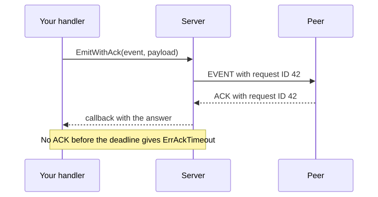

## 10. The journey of one message

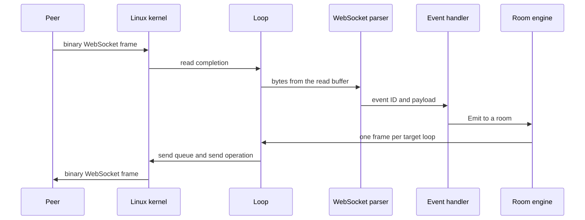

The payload is borrowed. It is valid only during the handler call. The server
returns the read buffer to the pool after the handler returns.

## 11. Old words and new words

| Old branch | New server | What it means |
| ---------- | ---------- | ------------- |
| `Subscriber` | `Conn` | The handle for one connection |
| `fd` | `ConnID{Slot, Gen}` | The safe name of a connection |
| `StartUp(n)` | `New(Config)` | Create the server |
| `On["chat"]` | `On(1024, handler)` | Bind a handler to a numeric event ID |
| `sub.Send(data)` | `c.Emit(event, data)` | Send to this connection |
| `EmitDirect(sub, event, data)` | `c.Emit(event, data)` | The same, through the Self-Room |
| `Emit(event, data, "room")` | `srv.To("room").Emit(event, data)` | Send to a room |
| `Broadcast(event, data)` | `srv.Broadcast(event, data)` | Send to all connections |
| `AddToRoom(sub, name)` | `c.Join(name)` | Join a room |
| `RemoveFromRoom(sub, name)` | `c.Leave(name)` | Leave a room |
| `GetRoomMembers(name)` | `srv.RoomSize(name)` | Count the members |
| `sub.Metadata` | `Conn` fields and rooms | Per-connection data |
| One goroutine per `Capture` | One loop per core | Who waits for the network |
| Text frames | Binary frames | The wire format |
| One frame per receiver | One shared frame | Fan-out cost |
| Room map keyed by fd | Sharded directory keyed by `Ref` | Room storage |
| `xsync.Map` | Sharded maps with locks | Concurrency style |

## 12. Your ideas that survived

The rewrite does not reject your design. It keeps the important ideas and
removes the costs.


The server also changes three costs: no goroutine for each connection, no
buffer for each idle connection, and no frame copy for each receiver.

## 13. How to read the code


Read the code in this order:

1. `docs/protocol.md` for the 16-byte envelope.
2. `connslab/slab.go` for the slot and the generation.
3. `room/directory.go` and `selfroom.go` for rooms.
4. `connslab/writeq.go` for the bounded queue.
5. `reactor/loop_linux.go` and the other `*_linux.go` files for the
   loop.

## 14. Rules you must obey

- A handler must not block. It runs on a loop thread. A blocked handler stops
  every connection on that core.
- A payload is borrowed. Do not keep it after the handler returns. Copy it
  first if you need it later.
- Check the `Emit` error. A full queue returns `ErrBackpressure` under the
  default policy.
- Use the Self-Room for a unicast send. Use a named room for a group send.
- Do not use a stale `ConnID`. The generation check protects the server, but a
  stale ID cannot reach a live connection.

## 15. Small glossary

| Term | Meaning |
| ---- | ------- |
| **ACK** | The envelope that confirms a request |
| **Envelope** | The first 16 bytes of a message |
| **Event ID** | The number that selects a handler |
| **Facade** | The public package that users import |
| **Frame** | One encoded WebSocket message |
| **Generation** | The number that makes a reused slot safe |
| **Loop** | One thread with one io_uring ring |
| **Ring** | The io_uring submission and completion queues |
| **Self-Room** | The implicit room of one connection |
| **Slice** | One package that owns one feature |
| **Slot** | The position of a connection in the table |
| **Write queue** | The frames that wait for the socket |

## 16. Measured results

These numbers come from the M2 report. The host is an 8 vCPU, 15.6 GiB Linux
virtual machine. The kernel is 6.8. The Go version is 1.27.2.

| Test | Result |
| ---- | ------ |
| 1,000,000 idle connections | 1,000,000 open, zero errors |
| Memory for each idle connection | 0.392 KiB |
| 1M echo run | 1,886,007 in, 1,886,007 out |
| Echo allocation | 0 bytes per operation |
| 8k Self-Room echo | 546,374 messages per second |
| Struct size: slot | 160 bytes |

The 60-minute hold and the 1M-member room fan-out are still open. See
`docs/benchmarks/` for the raw data and the commands.
